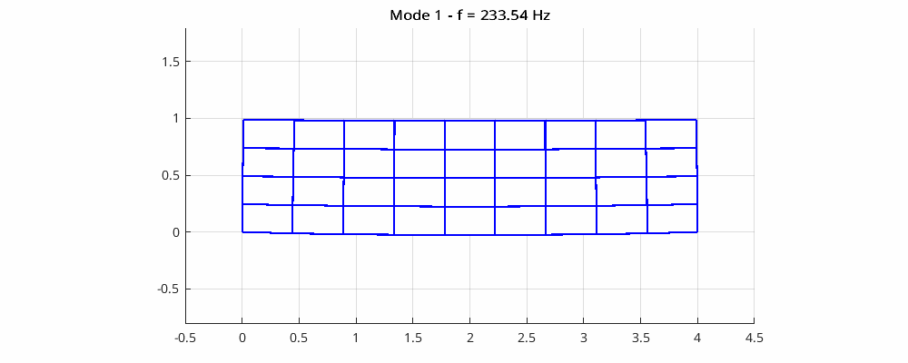
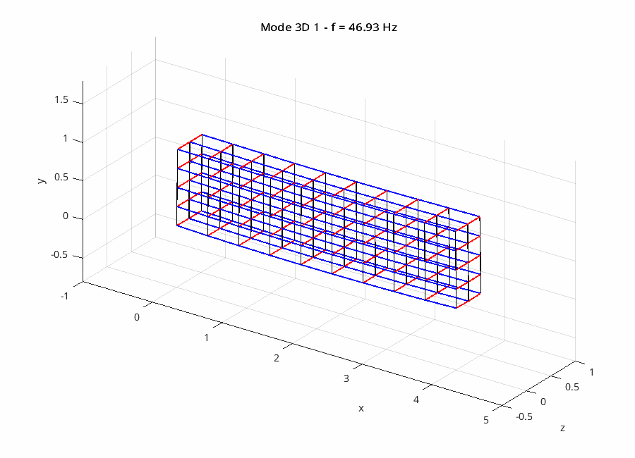

# Elasticity Spectral Analysis – 2D & 3D

Numerical mechanics project focused on the spectral analysis of
two- and three-dimensional elastic structures.

The objective is to discretize the elasticity problem, assemble sparse
matrices and compute the first vibration modes using iterative numerical methods.

## Main topics

- Linear elasticity
- 2D and 3D numerical modelling
- Sparse matrix assembly
- Boundary conditions
- Eigenvalue problems
- Shift-and-Invert
- GMRES
- ILU preconditioning
- Convergence and residual verification
- Visualization of vibration modes

## Technologies

- MATLAB
- Scientific computing
- Numerical linear algebra

## Examples

### 2D vibration mode

### 3D vibration mode

